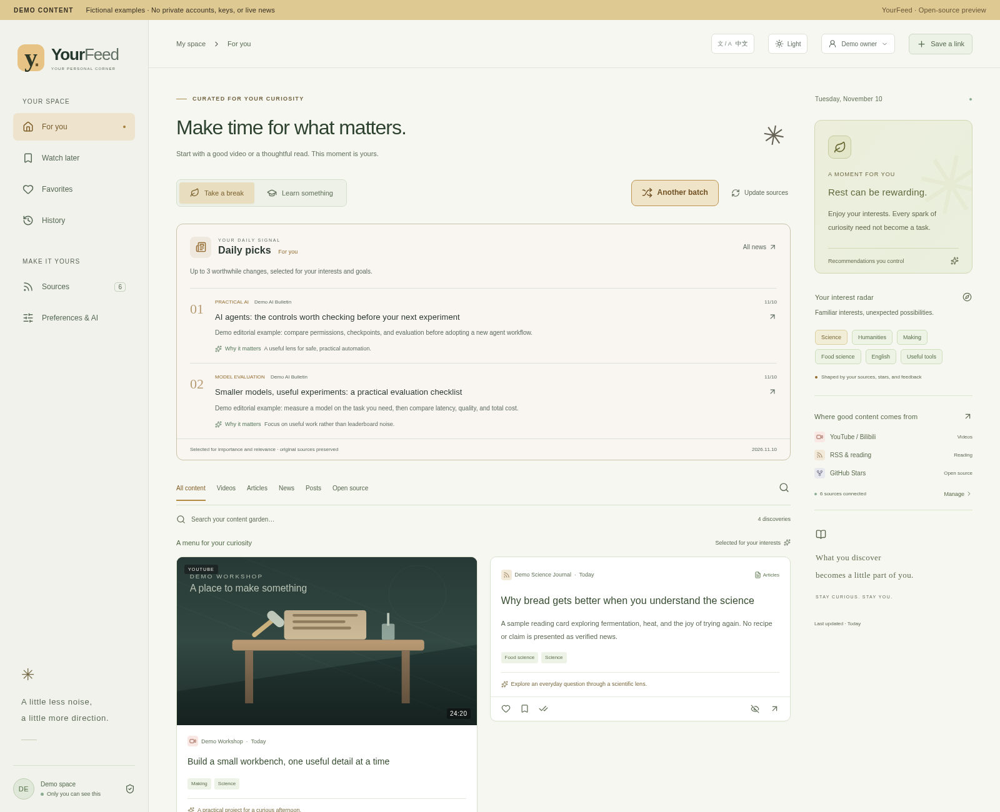
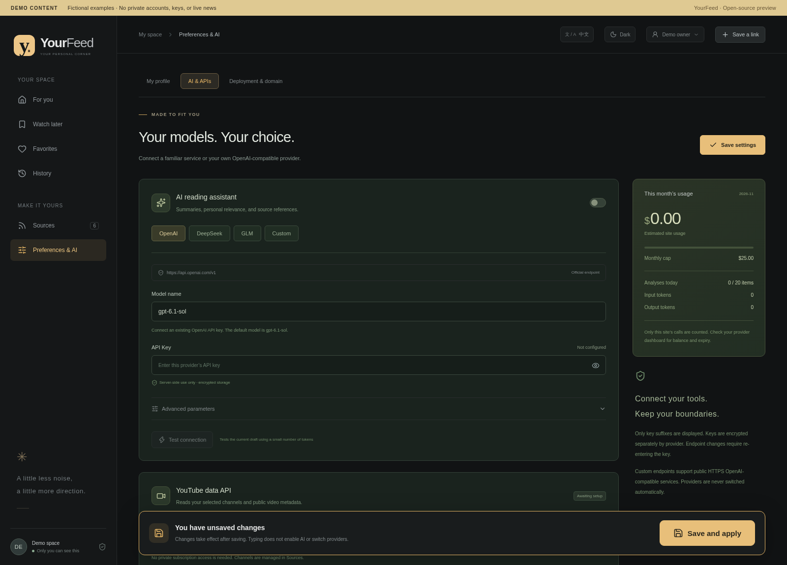
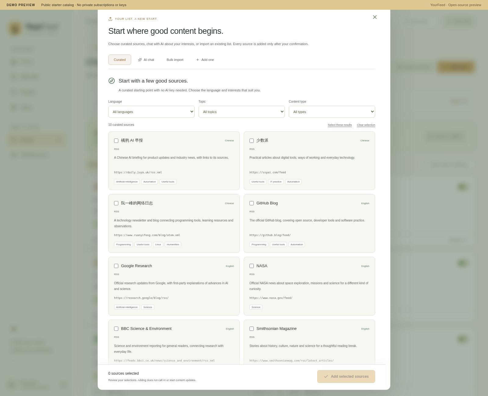
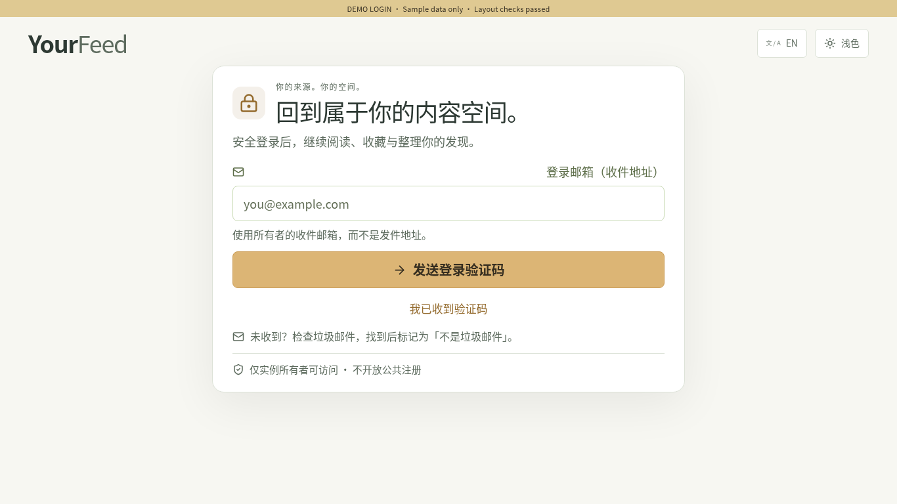
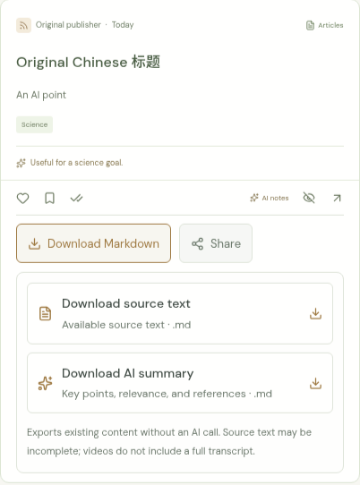
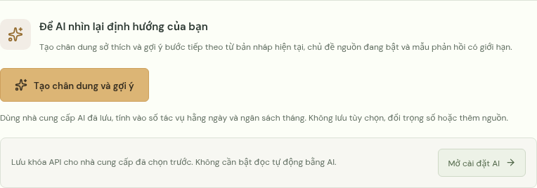

# YourFeed

[中文说明](README.zh-CN.md)

A private home for videos, articles, news, saved posts and open-source projects. Choose a relaxed feed for a break or a focused feed for your next step. Your sources and feedback shape the ranking; updates happen when you open the site or request them.

**Hosted owner instance:** [yourfeed.alan-xiaofei224.workers.dev](https://yourfeed.alan-xiaofei224.workers.dev)

**How to sign in:** this address is a private owner instance, not a public demo. Only its configured owner can sign in using the enabled email or OAuth methods; visitors cannot register or sign in with their own email. To explore the product, see the [screenshots](#interface-preview), or deploy your own instance below and sign in with the `OWNER_EMAIL` you configure there.

If a sign-in code is missing, check **Spam/Junk**. When you find the message, mark it **Not spam** so future codes are easier to find.

Google, GitHub and Facebook buttons appear only when the instance configures them. Facebook is for **already linked accounts**: first sign in by email or another enabled method, then link Facebook from the account menu after verifying your identity.

**Inspiration:** [Andrej Karpathy’s HackerTube post](https://x.com/karpathy/status/2116957135661945283). YourFeed carries the idea of a personal video space into a mixed home for reading, news, posts and open-source discoveries.

[](https://deploy.workers.cloudflare.com/?url=https://github.com/alanxiaofeifei/yourfeed)

This is Cloudflare’s official [Deploy to Workers](https://deploy.workers.cloudflare.com/) button. It passes this GitHub repository to Cloudflare’s deployment flow, which copies the repository and creates a Worker and D1 database in your own account.

Each deployment is independent: it does not copy the developer’s Cloudflare instance, database, keys, or personal data. You configure your own sign-in and API Secrets.

**Finish owner sign-in configuration before using the feed.** The button starts deployment; it does not configure your owner identity, sign-in provider or optional AI credentials for you. An unconfigured instance shows setup instructions and keeps private APIs closed. Google and GitHub sign-in are supported; email codes are optional. See the [deployment guide](docs/deployment.md).

`OWNER_EMAIL` is **your own sign-in and code-recipient email**. `onboarding@resend.dev` is a test **sender**, never your owner address; it can send only to the email used to register your Resend account. Normal email use requires a verified sending domain. Store `RESEND_API_KEY` as a Cloudflare **Secret**, not Text. A successful send request means the provider accepted it, not that it reached your inbox; rejected requests are shown as errors.

- One feed for video, reading, news, posts and projects; filters, saved items, history and source feedback. **Another batch** picks different cached recommendations under the current filters, without AI calls or source updates.
- English, Simplified Chinese, Traditional Chinese (Taiwan), and Vietnamese UI, a personal onboarding profile, and three editable starting directions: IT & AI practice, developers & creators, and knowledge explorer.
- RSS, public GitHub stars, YouTube metadata with your API key, best-effort Bilibili updates, and link imports.
- Optional AI reading through OpenAI, DeepSeek, GLM or an HTTPS compatible provider. Provider/model selection is explicit; daily limits, budget reservations and analysis caching bound usage. Prices and upstream subscriptions are separate from hosting.
- Owner-only standalone sign-in, server-side encrypted API keys, and an optional ChatGPT Sites adapter.
- A domain guide checks public DNS, HTTPS and this instance. It never collects Cloudflare management tokens or changes your sign-in origin.

Save content to your knowledge base with per-item Markdown exports (available source text or existing AI notes), copy the original link for sharing, and request an AI profile description with suggestions from your current preferences. The interface language does not translate original titles, content, or previously generated notes. See the bilingual [knowledge export and profile guide](docs/knowledge.md).

Need another interface language? Ask your AI to add a translation and send a pull request. 🐕 (Doge) The locale dictionaries live in `shared/locales/`; include the language selector, profile validation, AI output prompts and tests.

Source setup now includes a free curated catalog, AI interest conversations, and editable bulk imports (links, OPML, YouTube CSV and JSON). See the [source guide](docs/sources.md), [OAuth setup guide](docs/authentication.md), and [settings navigation preview](docs/screenshots/settings-sections.png).

## Interface preview

These are real React views rendered with clearly marked **demo content**. The feed stories and owner name are fictional examples, not live news or private subscription data. Source discovery shows the real public starter catalog; these are suggestions, not an owner’s subscriptions. A fresh deployment does not include this sample feed.

The deploy button uses this GitHub source to create an independent Worker and D1 database in your own Cloudflare account. You provide your own sign-in and API Secrets; the developer’s instance, database, keys and personal data are never copied.

**A mixed feed with Daily picks**



**AI settings with a persistent Save and apply bar**



**Start with curated sources, an AI conversation, or your own list**

Choose from public starter recommendations, talk about your interests with your configured AI, preview a bulk subscription list, or add one source. Nothing is added until you confirm.



**Readable owner sign-in**



**Keep discoveries in your knowledge base**

Download the available source text or existing AI notes as Markdown, or share the original publisher URL. Optional direct Google Notebook import requires separate consent and API setup; copying the URL and opening Notebook works without it. See [Notebook setup](docs/notebook.md).



**Ask AI to reflect on your interests — in your interface language**

An explicit action below the interest weights generates a preference portrait and suggestions, without changing your profile. This Vietnamese interface preview shows the action; it is not a live AI response.



## Who is it for?

- **IT & AI practice:** people building practical skills in IT, networking, Linux and workplace automation, with hands-on and science content for breaks.
- **Developers & creators:** people following programming, open source, AI tools and creative workflows, with room for making and visual ideas.
- **Knowledge explorer:** people who enjoy science, history, culture and thoughtful reading, while learning tools that support their next goal.

These are editable starting points. Every profile includes both rest and focused learning; your feedback takes priority over its initial interests.

## Start locally

Use Node.js 22.13 or later and npm.

```sh
npm ci
cp .env.example .dev.vars
# Fill instance settings and one OAuth provider; see docs/deployment.md.
npm run db:migrate:local
npm run dev
```

The example contains no usable credentials. Generate independent encryption and authentication secrets using `openssl rand -hex 32`. AI is optional and starts disabled; no provider fallback silently spends money with another service.

## Deploy and maintain

Read [deployment and sign-in](docs/deployment.md), [custom domains](docs/domains.md), and [backup and rollback](docs/backup-and-rollback.md). The standalone target is Cloudflare Workers with D1. The build supports a separate `YOURFEED_BUILD_PROFILE=sites` adapter; real Sites IDs and access settings belong only in your private deployment.

```sh
npm run typecheck
npm test
npm run build
# After reviewing the target account, D1 ID and secrets:
npm run deploy
```

`deploy` applies database migrations before publishing. Database migrations are not undone by a code rollback. Configure Cloudflare billing and service budgets for your own account; do not assume every workload fits a free tier.

Consumers can receive a reviewed shared-code update PR every six hours or manually. The updater protects deployment configuration, seed/profile files and local edits; it never merges, deploys or applies database migrations. Enable it using [the shared-core guide](docs/shared-core.md). Source updates are proposals requiring review.

## Architecture and limits

TypeScript, React/Vinext, Cloudflare Workers, D1 and Drizzle. Content is stored in your own instance. Platform players retain original attribution. Some videos cannot embed; external links remain available. Bilibili public endpoints can rate-limit or change. X and APPSO support link imports rather than a guaranteed free live API. AI notes identify whether they use full text, excerpts or metadata.

This project is for one owner per deployment. It is not a multi-tenant hosting service. Imported content is untrusted material, never a system instruction. Keep personal archives, keys, cookies and database exports out of Git.

MIT licensed. Third-party media, content and provider services retain their own terms.
