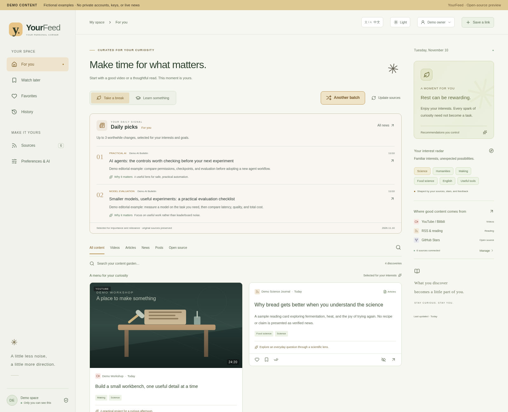
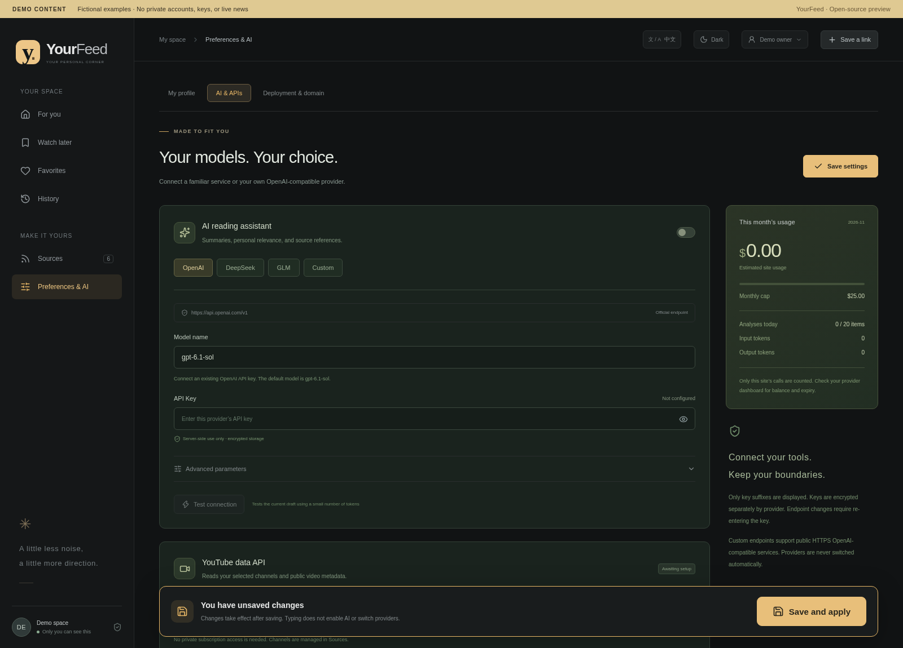
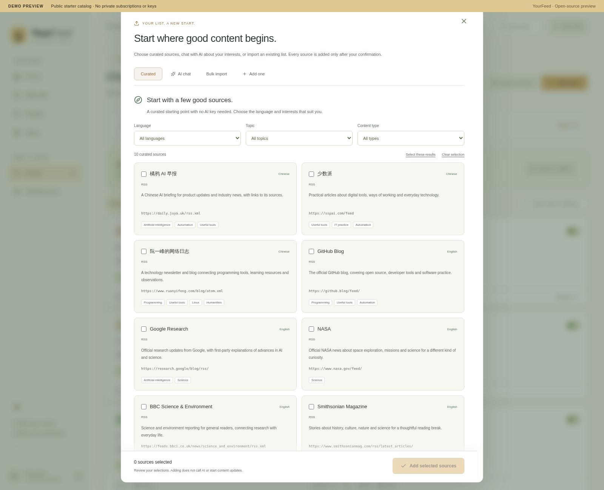
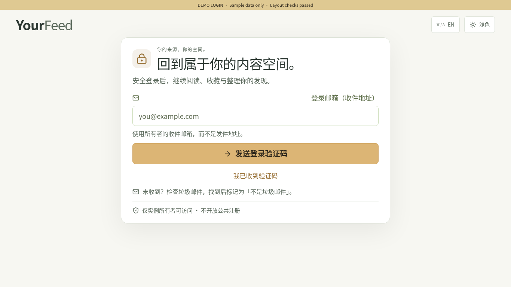
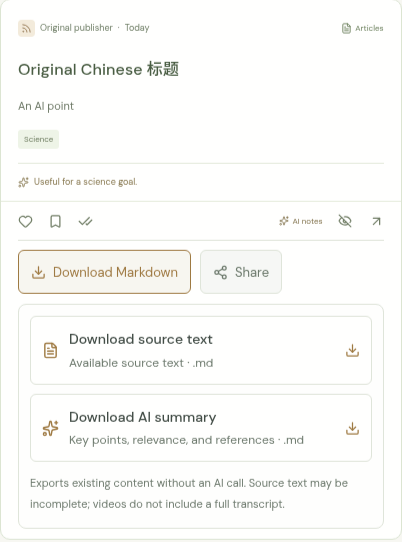
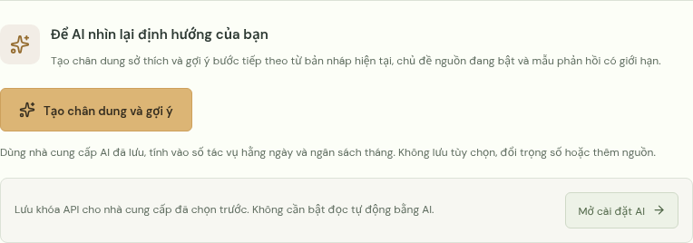

# YourFeed

[English](README.md)

把视频、文章、新闻、收藏帖子和开源项目放进自己的私人首页。休息时轻松发现，学习时专注进阶。由你的来源和反馈影响推荐，默认打开网站或手动操作时更新；后台更新需另行配置并主动开启。


## 首版介绍视频

**中文 · 55 秒 · 第一版。** 简短的动画介绍，不是当前界面实录，也不是首次配置教程。演示新闻与来源均为虚构示例；模型服务的免费额度和可用性以提供商政策为准。

<a href="https://alanzhu.dev/#yourfeed-video"></a>

[MP4](https://alanzhu.dev/assets/yourfeed-intro-zh-v1.mp4) · [YourFeed](https://yourfeed.alanzhu.dev/)

**项目／托管入口：**[yourfeed.alanzhu.dev](https://yourfeed.alanzhu.dev/)

**如何登录：**这个地址不开放公众注册，也没有共享演示账户。运营者完成独立实例配置并分配邀请后，受邀用户才能进入自己的实例。没有邀请可以先看[界面截图](#界面预览)，或通过下方按钮部署自己的实例，再使用该实例配置的 `OWNER_EMAIL` 登录。现有站点已部署，不等于新增托管流程、邮件和免费容量已经通过生产验收。

未收到登录验证码时，请检查**垃圾邮件**。找到邮件后标记为**「不是垃圾邮件」**，方便后续接收。

只有实例完成相应配置后，才会显示 Google、GitHub 或 Facebook 按钮。Facebook 仅供**已绑定账户登录**：首次先用邮箱或其他已启用方式登录，验证身份后再从账户菜单绑定 Facebook。

**项目灵感：**[Andrej Karpathy 关于 HackerTube 的原帖](https://x.com/karpathy/status/2116957135661945283)。YourFeed 将专属视频空间的想法，扩展为整合阅读、新闻、帖子与开源发现的个人首页。

[](https://deploy.workers.cloudflare.com/?url=https://github.com/alanxiaofeifei/yourfeed)

这是 Cloudflare 官方的 [Deploy to Workers](https://deploy.workers.cloudflare.com/) 部署按钮。链接会把本 GitHub 仓库交给 Cloudflare 的部署流程，在你自己的账户中复制仓库、创建 Worker 和 D1 数据库。

每个部署都是独立实例，不会复制开发者的 Cloudflare 实例、数据库、密钥或个人数据。你需要自行配置登录与 API Secrets。

**使用内容流前，需要完成本人登录配置。** 按钮只是部署入口，不会替你配置所有者身份、登录服务或可选的 AI 凭据。未配置的实例只显示设置指引，私人接口保持关闭。支持 Google、GitHub 登录；邮箱验证码是可选项，无需为了部署先购买邮件服务。详细步骤见[部署指南](docs/deployment.md)。

`OWNER_EMAIL` 填写**你本人用于登录和接收验证码的邮箱**。`onboarding@resend.dev` 只是测试**发件地址**，不是你的登录邮箱，而且只能给注册 Resend 的邮箱发信；正式使用需要验证自己的发件域名。`RESEND_API_KEY` 必须在 Cloudflare 中设为 **Secret（密钥）**，不要选 Text。发送接口成功仅表示服务商已受理，不代表邮件已到收件箱；请求被拒绝时网站会显示发送错误。

- 视频、阅读、新闻、帖子、项目混合推荐，支持筛选、稍后看、喜欢、足迹和来源反馈。
- 简体中文、繁體中文（台灣）、English、Tiếng Việt 四种界面语言，个人引导与三种可编辑起点：IT 与 AI 实践、开发与创作、通识探索。
- 支持 RSS、公开 GitHub Stars、使用个人 API Key 的 YouTube 元数据、尽力更新的 B 站接口及链接导入。
- 可选 OpenAI、DeepSeek、GLM、Google AI Studio (Gemini)、Groq、NVIDIA NIM、Cerebras 和兼容 HTTPS 接口。明确选择服务商与模型，以每日数量、预算预留和分析缓存限制使用，不会自动切换服务商产生费用。
- 独立部署仅本人登录，API Key 在服务端加密；保留可选 ChatGPT Sites 适配层。
- 域名向导检查公开 DNS、HTTPS 和当前实例，不收集 Cloudflare 管理令牌，不自动修改登录主地址。

每条内容支持将可取得的来源文字或已有 AI 笔记导出为 Markdown，复制原始内容链接分享；也可以根据当前偏好，请 AI 生成画像描述和建议。切换界面语言不会翻译原始标题、原文或已生成的笔记。详见双语[知识库导出与画像指南](docs/knowledge.md)。

需要其他界面语言？请自己的 AI 帮忙翻译就行，也欢迎提交 PR。🐕（Doge）词典在 `shared/locales/`，记得同步语言选择、偏好校验、AI 输出提示和测试。

添加来源支持免费精选目录、AI 兴趣对话和可编辑的批量导入（链接、OPML、YouTube CSV、JSON）。推荐流的「换一批」会在当前筛选下避开最近内容，不触发 AI 或来源更新。参见[来源使用指南](docs/sources.md)、[社交登录配置指南](docs/authentication.md)与[大卡片设置导航预览](docs/screenshots/settings-sections.png)。

## 自建与独立受邀托管

**候选版本状态：**下一阶段能力已写入源码并进行自动化检查；这不表示上面的公开网址或 AlanFeed 已运行本候选版本。五个受邀生产实例、正式发信域名和免费额度验收仍需运营者完成。AlanFeed 结构变更发布须先解决平台支持的数据库备份／恢复通道。

可以一人自建，也可以给受邀用户提供独立实例：**每人一个 Worker、一个 D1、独立密钥与会话**，另设只管理邀请和名额的控制服务。默认最多五个已预约／已启用名额，其他 MIT 运营者可以按自己的资源调整并用于商业托管；项目不包含支付计费，也不保证五人免费。受邀者自行填写 AI／YouTube API，缺少密钥时不会使用运营者个人 Key 兜底。参见[受邀托管指南](docs/hosting.md)及[容量与运维检查](docs/next-stage-operations.md)。

阅读可靠性升级包括内容覆盖度与截断标识、数据库历史／搜索、增量采集、多出处关联、订阅导出与可选本地阅读缓存。本地缓存需用户主动确认个人设备，不是备份；普通托管正文缓存默认 90 天，配提醒和导出。已有私人 Sites 数据不会自动清理。参见[来源验证和开源项目比较](docs/source-research.md)。

**部署状态：**Cloudflare 是原生目标，官方按钮仍需配置账户、网址、登录、数据库和密钥。首次部署会检查空数据库，已有实例更新需要私有备份与目标清单。其他平台的适配或待验证状态见[部署矩阵](docs/deployment.md#deployment-destinations-and-honest-buttons)，不提供虚构一键按钮。源码和测试不能代替真实受邀登录、邮件、OAuth 或免费额度验收。

## 界面预览

以下截图使用真实 React 界面，并明确标记为**演示内容**。示例新闻与所有者名称为虚构展示数据，不是实时新闻或私人资料。来源发现页展示真实的公开推荐目录，只是通用起点，不是某位所有者的订阅。新部署不会预装这组演示内容。

部署按钮从本 GitHub 开源源码，在你自己的 Cloudflare 账户创建独立 Worker 和 D1 数据库。需要自行配置登录与 API Secrets；不会复制开发者的实例、数据库、密钥或个人数据。

**混合内容首页与今日必看**



**AI 设置与始终可见的保存栏**



**从新手推荐、AI 对话或已有清单开始**

可以从公开精选来源起步，用已配置的 AI 聊聊兴趣，预览批量订阅清单，或单条添加。只有确认后才会保存来源。



**清楚易读的本人登录页**



**把好内容留在自己的知识库**

按条目下载已获取的来源文字或已有 AI 笔记为 Markdown，也能分享原始来源链接。Google Notebook 直接导入需要单独配置与授权；无需配置即可复制链接并打开 Notebook。详见 [Notebook 指南](docs/notebook.md)。



**在兴趣权重下面，请 AI 看看当前方向**

生成画像和建议需要主动点击，不会直接修改偏好。下面是越南语界面的按钮预览，不是实际 AI 回复。



## 适合谁？

- **IT 与 AI 实践：**希望积累 IT、网络、Linux 和工作自动化能力，同时在休息时看看动手实践、科学内容的人。
- **开发与创作：**关注编程、开源、AI 工具和创作流程，也喜欢制作与视觉灵感的人。
- **通识探索：**享受科学、历史、人文和深度阅读，希望学习能帮助下一阶段目标的工具的人。

这三种只是可编辑的起点，每种都兼顾休息和学习。你的反馈会逐渐优先于初始兴趣。

## 本地开始

需要 Node.js 22.13 以上和 npm。

```sh
npm ci
cp .env.example .dev.vars
# 填写实例配置和一种 OAuth 登录方式，见 docs/deployment.md。
npm run db:migrate:local
npm run dev
```

示例不含可用凭据。使用 `openssl rand -hex 32` 分别生成两个不同的加密、登录密钥。AI 默认关闭；模型费用、第三方 API 费用和托管费用分别由各自服务商计费。

## 部署与维护

阅读[部署与登录](docs/deployment.md)、[自定义域名](docs/domains.md)、[备份和回滚](docs/backup-and-rollback.md)。默认部署目标为 Cloudflare Workers + D1。`YOURFEED_BUILD_PROFILE=sites` 提供独立的 Sites 构建适配；真实 Sites ID 和访问设置只应保存在你的私人部署中。

```sh
npm run typecheck
npm test
npm run build
# 检查目标账户、D1 ID、密钥后再执行：
npm run deploy
```

`deploy` 会先执行数据库迁移，再发布代码。代码回滚不会撤销数据库迁移。请按自己的账户设置 Cloudflare 计费与预算，不要假定所有工作负载始终免费。

可以每六小时或手动生成共享代码更新 PR。更新器保护部署配置、个人种子资料和本地改动，不自动合并、不部署、不执行数据库迁移。启用方法见[共享核心更新](docs/shared-core.md)。所有更新需要你审阅。

## 技术与限制

TypeScript、React/Vinext、Cloudflare Workers、D1 和 Drizzle。内容保存在自己的实例中，视频保留官方播放器与出处。部分视频无法嵌入时提供原站链接。B 站公开接口可能限流或变化；X 与 APPSO 支持链接导入，不承诺免费实时接口。AI 笔记会说明基于正文、摘要还是元数据。

每个部署服务一位主人，不是多人托管平台。外部内容只是资料，不是系统指令。请勿把个人档案、密钥、Cookie、数据库导出提交到 Git。

MIT 许可；第三方内容、媒体及服务遵循各自条款。
