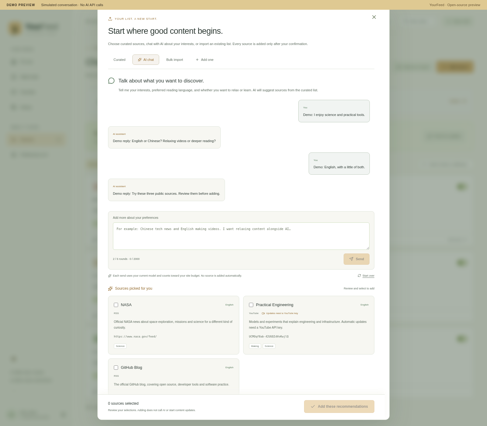

# 添加内容来源 / Add sources

在「内容来源 → 添加来源」选择一种方式：

- **精选推荐**：不需要 AI Key。按语言、主题和内容类型筛选公开来源，勾选后添加。YouTube 来源会标明更新需要 YouTube API Key。
- **AI 对话**：先在「偏好与 AI 设置 → AI 与接口」配置并保存可用的 API。用文字说明兴趣、阅读语言和休息或学习目标；AI 从已验证的推荐目录中建议来源，确认后一次添加。每次发送计入本站每日 AI 任务上限与月预算。
- **批量导入**：粘贴链接、JSON 清单，或读取 OPML、YouTube Takeout 订阅 CSV、TXT 文件。普通预览无需 AI；「AI 辅助识别」使用当前已配置的提供商。系统会尝试识别网站真实声明的同站 RSS，识别失败时保留为手动来源。
- **单条添加**：手动填写平台、地址和主题。

批量预览最多 100 条，每次确认添加最多 50 条，网站会按每次 10 条自动连续处理并显示进度。提交前可编辑候选，只添加选中的条目；重复来源会跳过，既有屏蔽、暂停和阅读记录保持不变。部分失败时保留失败条目，可修正后重试。

添加来源不会自动触发 AI 阅读或切换模型。返回首页手动刷新可获取新内容。请只在专用设置输入 API Key，不要在导入清单或对话粘贴密码、密钥、退订链接或带令牌的私人地址。

## English

Open **Sources → Add sources**:

- **Curated** needs no AI key. Filter public suggestions by language, topic and content type, then select and add. YouTube entries indicate that updates need a YouTube API key.
- **AI chat** uses the provider saved under **Preferences & AI → AI & APIs**. Describe your interests, preferred language and whether you want a break or focused learning. The assistant recommends entries from the verified catalog; review and add them together. Each send counts toward the site's daily AI task limit and monthly budget.
- **Bulk import** accepts pasted links, JSON, OPML, YouTube Takeout subscription CSV and TXT. Ordinary previews need no AI; AI-assisted recognition is explicit. Real same-site alternate RSS declarations can be discovered; websites without a verified feed remain manual sources.
- **Add one** keeps the ordinary platform, address and topic form.

Preview up to 100 candidates and confirm up to 50 per action; the UI sends sequential groups of 10 and displays progress. Candidates are editable and only selected entries are added. Duplicates are skipped without changing existing block, pause or reading controls. Partial failures remain available for correction and retry.

Adding sources does not enable AI reading or switch models. Refresh the home feed to fetch content. Enter API keys only in their dedicated settings, never in an import or chat. Do not paste passwords, unsubscribe links or token-bearing private URLs.
